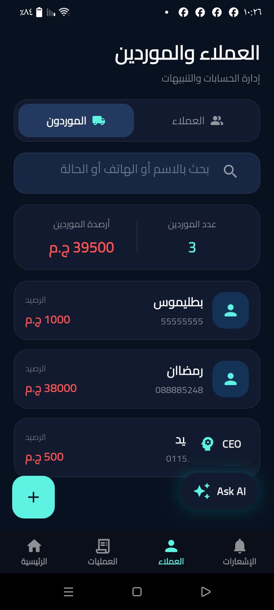
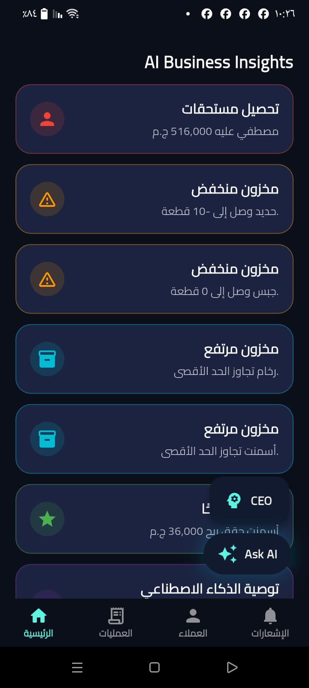
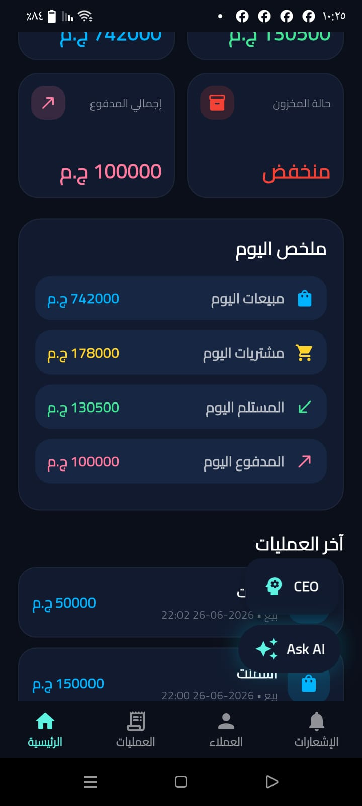
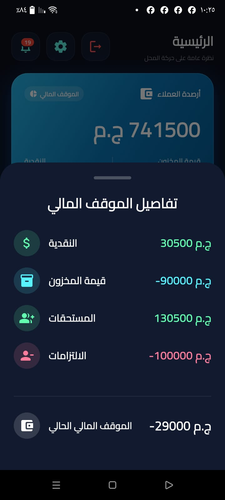
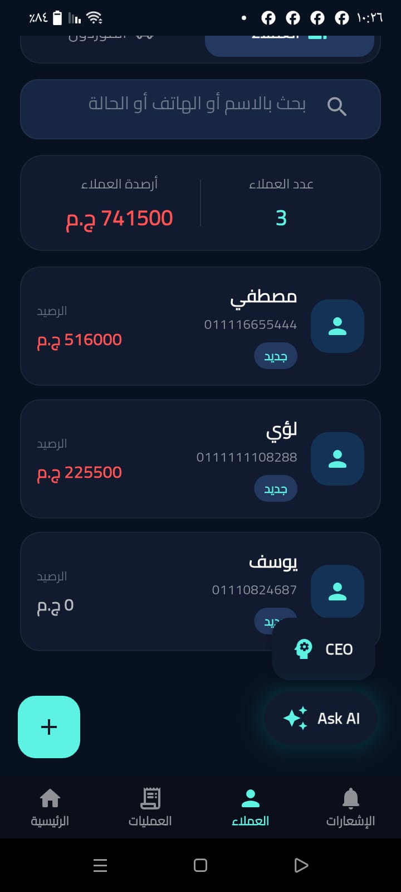
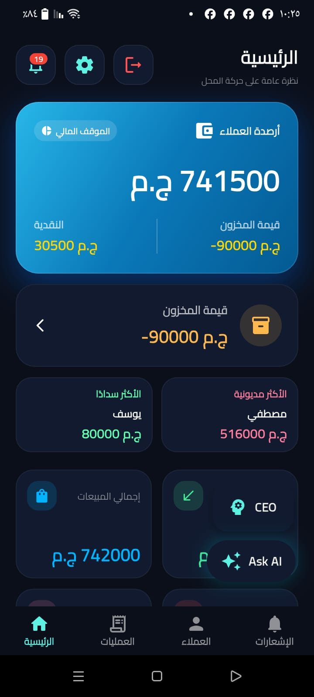
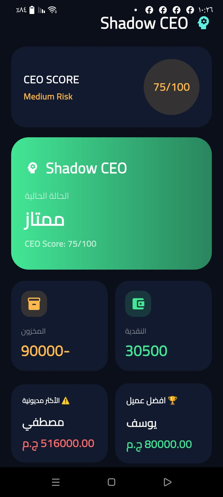

# Cash Flow 💰

> **Mobile Accounting & Business Management Platform**

Cash Flow is a Flutter-based mobile application designed to help small-business owners manage customers, suppliers, products, transactions, cash flow, inventory, and business insights from one place.

The project combines a mobile frontend with REST API integration and database-backed business workflows, with AI-assisted features for business analysis.

---

## 📱 Screenshots

### Dashboard & Financial Overview

<p align="center">
  
  
</p>

### Customers & Suppliers

<p align="center">
  
  
</p>

### Operations & Transactions

<p align="center">
  
  
</p>

### AI & Business Intelligence

<p align="center">
  
  
  
</p>

---

## ✨ Key Features

- 🔐 User authentication and persistent login state
- 📊 Financial dashboard and business overview
- 👥 Customer and supplier management
- 📦 Product and inventory management
- 💰 Sales and purchase operations
- 💳 Payments and collections
- 🔔 Notifications and business alerts
- 🤖 AI Business Assistant
- 🧠 AI-powered business insights
- 👔 Shadow CEO / CEO Score
- 📈 Financial position and transaction analysis
- ⚙️ Profile and application settings

---

## 🛠️ Tech Stack

| Layer | Technology |
|---|---|
| Mobile App | Flutter / Dart |
| UI | Flutter Material UI |
| Backend API | PHP REST API |
| Database | MySQL |
| API Communication | HTTP / JSON |
| Local Storage | SharedPreferences |
| AI Features | AI Business Assistant / Insights |

---

## 🏗️ Architecture

```text
┌──────────────────────────────┐
│      Flutter Mobile App      │
│                              │
│  UI • Business Logic • State │
└──────────────┬───────────────┘
               │
               │ HTTP / JSON
               ▼
┌──────────────────────────────┐
│        PHP REST API          │
│                              │
│ Authentication • Operations  │
│ Business Data • AI Features  │
└──────────────┬───────────────┘
               │
               │ Database Queries
               ▼
┌──────────────────────────────┐
│            MySQL             │
│                              │
│ Users • Customers • Products │
│ Suppliers • Transactions     │
└──────────────────────────────┘
```

---

## 📂 Project Structure

```text
cash_flow/
│
├── android/
├── ios/
│
├── assets/
│   └── images/
│
├── lib/
│   ├── main.dart
│   ├── screens/
│   ├── services/
│   ├── widgets/
│   └── ...
│
├── README.md
├── pubspec.yaml
├── pubspec.lock
└── .gitignore
```

---

## 🚀 Getting Started

### Prerequisites

- Flutter SDK
- Dart SDK (included with Flutter)
- Android Studio or VS Code
- Android emulator or physical device
- Accessible PHP REST API + MySQL backend

### Installation

Clone the repository:

```bash
git clone https://github.com/hebala889/cash_flow.git
```

Navigate to the project:

```bash
cd cash_flow
```

Install dependencies:

```bash
flutter pub get
```

Run the application:

```bash
flutter run
```

Make sure the backend/API configuration points to a reachable server before testing features that communicate with the backend.

---

## 🎯 Project Goal

Cash Flow was built to provide small-business owners with a practical mobile tool for managing day-to-day financial and operational activities while turning business data into actionable insights.

---

## 🤖 AI Business Features

The application includes AI-assisted functionality designed to help business owners understand their business data and make better decisions.

Key AI-related features include:

- AI Business Assistant
- Business Insights
- Financial analysis
- Shadow CEO / CEO Score
- Business performance indicators

---

## 💼 Core Business Modules

### 👥 Customers

Manage customer information, balances, transactions, and financial relationships.

### 🏢 Suppliers

Track suppliers, balances, purchases, and payment-related activities.

### 📦 Inventory

Manage products and monitor inventory-related information.

### 💰 Transactions

Handle core business operations including:

- Sales
- Purchases
- Payments
- Collections

### 📊 Financial Dashboard

Provide an overview of important business and financial information in one place.

---

## 🔌 Backend Integration

The Flutter application communicates with a PHP REST API using HTTP/JSON.

```text
Flutter Mobile App
        │
        │ HTTP / JSON
        ▼
   PHP REST API
        │
        │ Database Queries
        ▼
       MySQL
```

---

## 🧠 Business Intelligence

Cash Flow transforms stored business data into useful information through financial dashboards and AI-assisted insights.

This allows business owners to get a clearer view of:

- Financial position
- Customer activity
- Supplier activity
- Inventory
- Transactions
- Business performance

---

## 🔐 Authentication

The application includes user authentication and persistent login functionality.

Authentication-related functionality includes:

- User login
- Session persistence
- Secure access to business data
- User profile and settings

---

## 🔔 Notifications

The application provides notifications and business alerts to help users stay aware of important activities and updates.

---

## 📱 Mobile Experience

Cash Flow is designed as a mobile-first business management application with a dashboard-oriented interface that allows users to access important business information quickly.

---

## 🎥 Demo

A demo video of the Cash Flow application is available as part of the project portfolio.

---

## 🎯 Target Users

Cash Flow is designed primarily for:

- Small business owners
- Retail businesses
- Local merchants
- Entrepreneurs
- Businesses that need simple financial and inventory management

---

## 📌 Project Highlights

The project demonstrates practical experience in:

- Flutter mobile development
- REST API integration
- Backend communication
- MySQL database integration
- Authentication systems
- Business workflow design
- Inventory management
- Financial data management
- AI-assisted business applications
- Mobile UI development

---

## 🛠️ Development Technologies

```text
Frontend
└── Flutter
    └── Dart

Backend
└── PHP
    └── REST API

Database
└── MySQL

Communication
└── HTTP / JSON

Local Storage
└── SharedPreferences

AI
├── AI Business Assistant
├── Business Insights
└── Shadow CEO
```

---

## 📈 Future Improvements

Potential future improvements include:

- Advanced financial reports
- More AI-powered recommendations
- Enhanced analytics dashboards
- Cloud-based deployment
- Automated business reporting
- Advanced inventory forecasting

---

## 👨‍💻 Project

**Cash Flow — Mobile Accounting & Business Management Platform**

Developed using:

**Flutter · Dart · PHP REST API · MySQL · AI-assisted business features**

---

## 🔗 Repository

**GitHub:**

https://github.com/hebala889/cash_flow

---

## ⭐ About the Project

Cash Flow is a practical software engineering project focused on solving real-world business management problems through a combination of mobile application development, backend APIs, database systems, and AI-assisted business intelligence.
